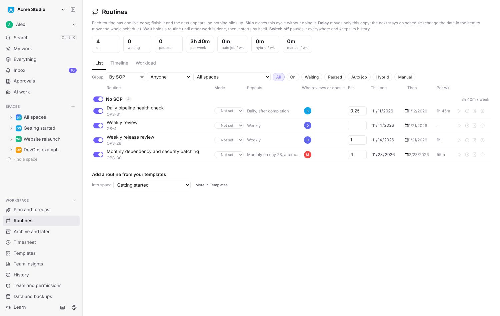
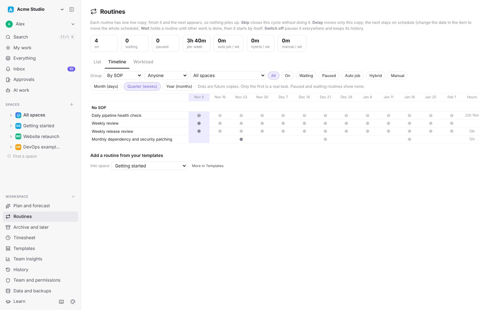
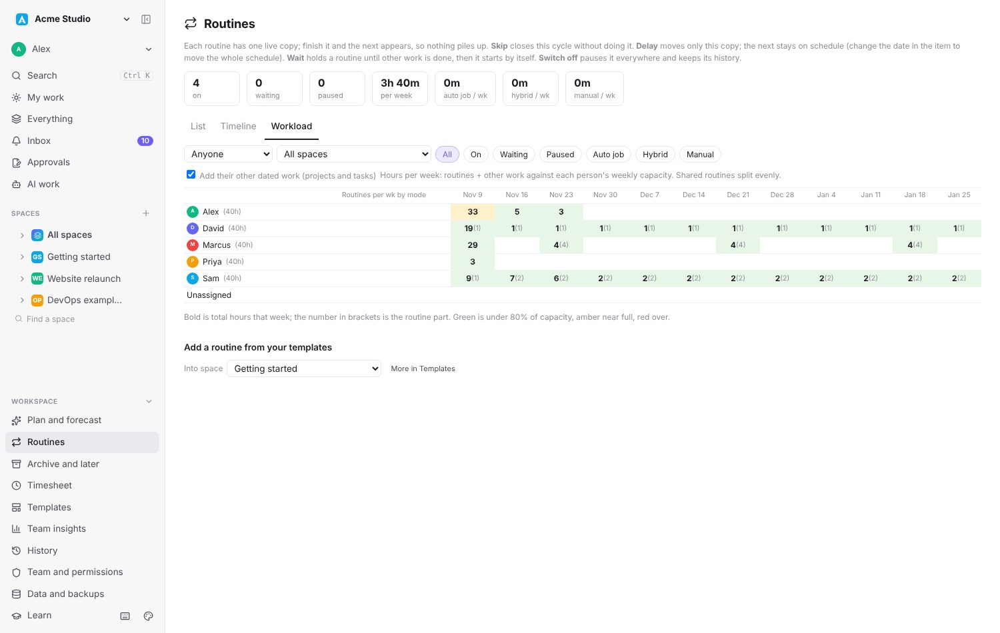
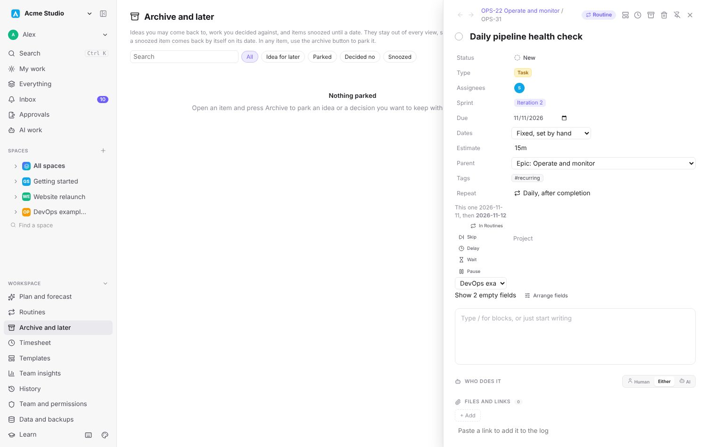
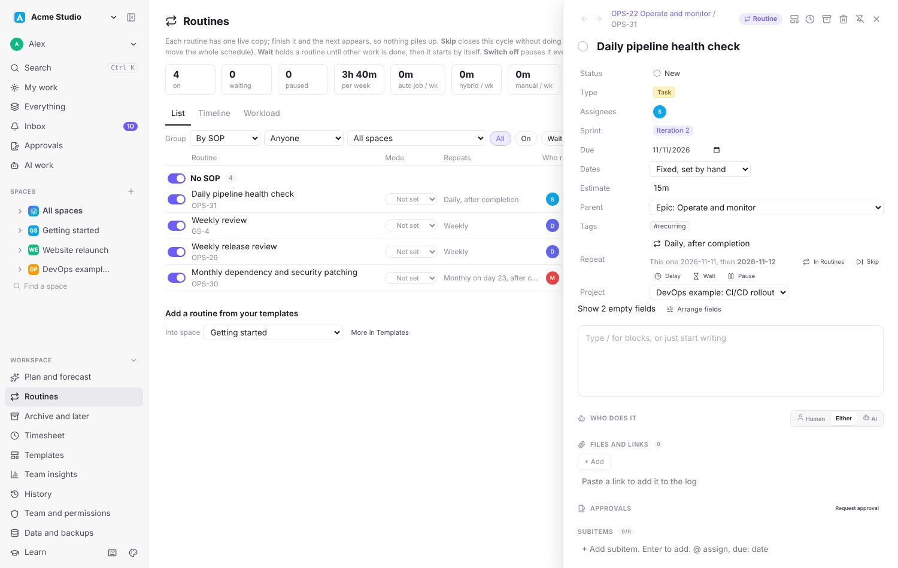
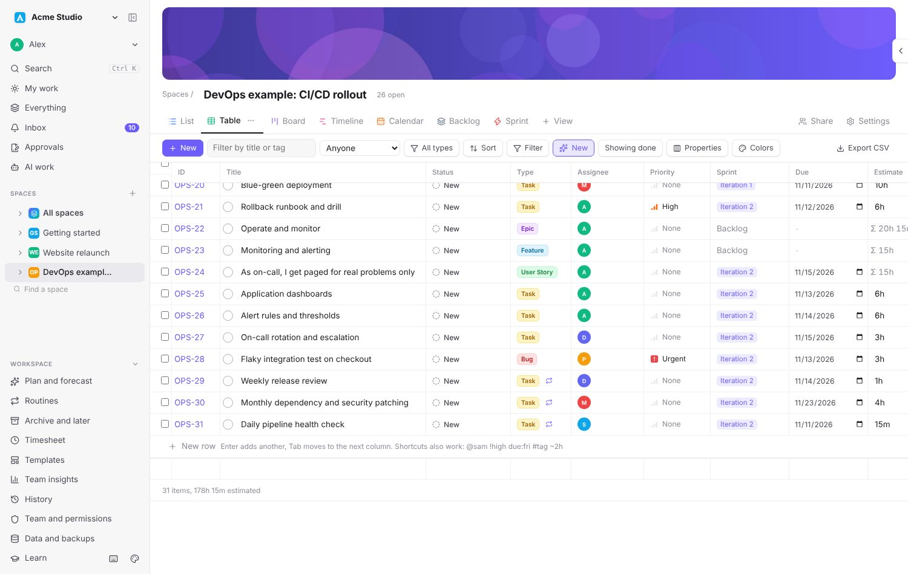

# Cadence

A fast, self-hosted project and task manager that takes the best parts of ClickUp, Notion, Asana, Jira, Linear and Azure Boards, with AI agents as first-class teammates.

One person or a whole company: keep separate workspaces for each business and for personal life, see everything due today across all of them, and let AI agents (Claude or any MCP client) plan, do and report on work while people approve it.


## Quick start

Needs Node 24 or newer (it uses the built-in `node:sqlite`) and pnpm.

```bash
pnpm install
pnpm demo
```

The demo opens on http://localhost:5191 with sample data: an "Acme Studio" work workspace and a "Personal" workspace. It keeps its data in `demo-data/`, apart from your own.

```bash
pnpm dev
```

Runs on http://localhost:5190 and keeps data in `data/`: one SQLite file per workspace, plus uploaded files and backups.

```bash
pnpm test
```

## Hosting with sign-in

```bash
pnpm build
pnpm start
```

Serves the app and API on http://127.0.0.1:8080 (set `PORT` and `HOST` to change). Sign-in is required: the first visit asks you to create the owner account, which becomes admin of every workspace. Invite everyone else from the Team page. One account works across all workspaces it belongs to.

- Put it behind HTTPS (Caddy, nginx or a tunnel) that sets `X-Forwarded-Proto`, so session cookies are marked Secure.
- `CADENCE_REQUIRE_LOGIN=0` turns forced sign-in off; `pnpm dev` leaves it off for local use.
- Locked out: `pnpm reset-password you@example.com` on the server prints a new password.
- People can create their own account only if the owner opens sign-up (Team page, Server); otherwise by invite.

### Passwordless sign-in
People sign in with "Continue with Google" or "Email me a sign-in link"; a password stays available behind "Use a password instead". Only existing accounts can sign in this way; new people join through an invite (a name is enough, a password is optional). Settings are environment variables (see `.env.example`); with none of them set, sign-in works with passwords as before.

- `PUBLIC_URL`: the address people use, for example `https://cadence.example.com`. Every emailed link (sign-in links, invites) starts with it, never with the request's Host or Origin. Needed for both new sign-in methods, and for connecting Claude by signing in (docs/MCP.md).
- `GOOGLE_CLIENT_ID`, `GOOGLE_CLIENT_SECRET`: a Google OAuth client of type Web application with the redirect URI `{PUBLIC_URL}/auth/google/callback`. Shows the Google button. This is separate from the Google client on the Team page, which connects the Gmail sender and calendars.
- `STAFF_GOOGLE_DOMAIN`: accounts on this domain sign in only with Google (no email link, no password), so Google Workspace 2-Step Verification covers them. Applies only while Google is configured. API tokens (MCP) are not affected.
- `SMTP_HOST`, `SMTP_PORT` (465 implicit TLS, 587 STARTTLS), `SMTP_FROM`, optional `SMTP_USER` and `SMTP_PASS`: system mail for sign-in links and invites. Without SMTP, mail goes through the main workspace's connected Gmail sender; without either, sign-in links are printed in the server log. The email-link button shows when mail can go out, or when `PUBLIC_URL` is a localhost address (links in the log, for development).
- Sign-in links work once, for 15 minutes; a new one voids older ones. At most 5 per email and 10 per IP in 15 minutes. The link opens a page with a Sign in button, so mail scanners that open links do not use them up.
- Every sign-in attempt (time, email, method, result, IP, user agent) is appended to `signin-log.jsonl` in the data folder. Tokens and passwords are never logged.

### Behind Coolify or another HTTPS proxy
Set `PUBLIC_URL` (see `.env.example`). Emailed links use it. Without it, the Gmail sender and Google calendar connections fall back to the address the proxy forwards (`X-Forwarded-Proto`/`X-Forwarded-Host`), so they still use https.

### Encrypted cloud backups
Set `CADENCE_BACKUP_S3_ENDPOINT`, `CADENCE_BACKUP_S3_REGION`, `CADENCE_BACKUP_S3_BUCKET`, `CADENCE_BACKUP_S3_KEY_ID`, `CADENCE_BACKUP_S3_SECRET` (any S3-compatible bucket: Backblaze B2, Cloudflare R2, AWS) and `CADENCE_BACKUP_PASSPHRASE`. Every snapshot is then gzipped, encrypted (AES-256-GCM) and uploaded. `pnpm decrypt-backup <file.enc>` turns a download back into a database file. Keep the passphrase in a password manager: without it the backups cannot be opened.

### Personal spaces and My data
Anyone can create a personal space (New space, Personal). Only they see it, admins included, until they use Share on the space header. My account, My data downloads everything a person can see plus their layouts, and restores personal spaces and layouts by merging.

### On phones
Cadence installs as an app. On iPhone or iPad, open your server's address in Safari, tap Share, then Add to Home Screen. On Android or desktop Chrome and Edge, use Install app in the address bar or menu. Phones get a tab bar (My work, Inbox, new task, Search, Spaces), and a tap on a task opens it full screen.

Notifications: Inbox, Settings, Turn on, on each device. They arrive with the app closed, on desktops too. Choose which kinds to get, set quiet hours, or pause for an hour or until tomorrow; the Inbox always keeps everything. Push needs HTTPS (localhost works for testing), and on iPhone the app must be added to the Home Screen first. `CADENCE_PUSH_CONTACT` (for example `mailto:you@example.com`) sets the contact push services see; it defaults to the owner's email.

## Screenshots

| | |
| --- | --- |
|  |  |
|  |  |
|  |  |
|  |  |
|  |  |
|  |  |
|  |  |

## Features

### Work and structure
- Workspaces for each company or for personal life, each with its own data, files, backups and sign-in. Switch from the top of the sidebar or with Alt+1..9.
- Workspaces hold spaces (a team or area: Engineering, QA, Sales). Each space picks its levels when created: General (Project, Phase, Task, Subtask), Simple, Jira style (Project, Epic, Story, Subtask), Azure DevOps (Epic, Feature, User Story, Task), or your own. Statuses grouped into to do, doing and done, and custom fields. (The API calls a space a project.)
- Rollup space: one space that shows work from all spaces, or the ones you pick, in every view.
- Unlimited nesting, dependencies, multiple assignees, priorities, tags, estimates, start and due dates.
- Sidebar: search, favorites, drag to reorder, an icon and color kit per space; an arrow shows a space's views. Double-click a space or view name to rename it. Private spaces sit under "Private to me".
- Rename a space's key (NT to GEN) and old keys like NT-12 keep working.

### Routines (repeating work)
- One live copy per routine; finish it and the next appears, so nothing piles up.
- A built-in Routines space, always in the sidebar: a Routines view (group by SOP, frequency, person, space or mode; switches; edit owner, estimate, date and mode inline) plus the usual Table, Board, Timeline, Calendar and Workload views, with Mode, On/off, Then and SOP columns. Workload counts every date a routine comes back.
- Auto-job routines are assigned to AI agents only (the agent's owner reviews).
- Per routine: switch off (pause), Skip this one, Delay only this copy (the next stays on schedule), Wait until other work is done (a hire, a setup), or End. Switch a whole SOP off at once.
- Each task that repeats shows a Routine chip in its header and a repeat mark in lists, tables and boards; both open it on the Routines page.
- SOP links: tag work with an SOP code (`SOP-07.2`) and it opens that SOP's document.

### Archive and later
- Archive ideas (maybe later), parked work (not now) and rejected items (decided no) without deleting them, or snooze an item until a date. They live in the built-in Archive and later space (Table, List, Board) with Parked as, Reason, Snoozed until and Restore columns.

### Views
- List: an outline with nesting. Enter adds the next item, Tab indents, a hover gutter adds above or below and drags.
- Table: spreadsheet editing, resizable and reorderable columns, multi-level sort, filters, a property visibility panel, column totals (sum, average, min, max, counts, percent), and virtual scrolling for large tables.
- Board: Kanban by any field, swimlanes, WIP limits, card covers from image attachments.
- Sort works in every view: rows in tables, lists and timelines, cards in boards, items within a calendar day, and workload lists (priority, due, status, any column).
- Timeline (Gantt): drag to move and resize, drag to link dependencies, parent spans, critical path, named baselines, sprint bands, and an overrun marker when subtasks run past a parent.
- Calendar, Workload (hours per person against capacity), Backlog, Sprint (burndown, velocity, capacity, rollover), and Files.
- Everything: one dashboard, calendar, timeline and list across all your workspaces, all editable.

### Columns and fields
- Text, number, money, select, multi-select, date, person, checkbox, URL, phone, email, rating, files.
- Relation (link items across spaces), rollup (count, sum, average, min, max, progress, earliest or latest due, over subitems or related items), and formula (math, text, logic and date functions over other columns).
- Automatic: created time, last edited time, created by.

### Writing fast
- Quick add everywhere: `Call vendor @sam !high #ops due:fri ~2h every:2w`. Typing `@`, `!`, `#`, `due:` or `every:` opens a picker, and the preview shows real dates. Ctrl+Space adds your defaults from the New line menu (assignee, due, priority, estimate, sprint, tags).
- New items are tinted for a few minutes and the view jumps to them; turn either off in the New menu. Filters can match "created in the last N minutes".
- Quick capture from anywhere (C), with dictation. Command palette (Ctrl+K). Rebindable shortcuts.
- Block editor for descriptions: headings, lists, checklists, code, images (paste a screenshot), links to other items with `[[KEY-12]]`.

### Files
- Attach images, PDFs, Office documents and text to any item. Paste screenshots straight into descriptions.
- Drop files onto a List, Board or Files view to turn each file into its own task.
- A Files view per space (gallery or table) and a Files column.
- Quick view for images, PDFs and Google Drive, Docs, Sheets and Slides links.

### Repeating work and templates
- Repeat on a schedule or after completion: daily, weekdays, weekly on chosen days, monthly by date or nth weekday, quarterly, twice a year, yearly, every 2, 3 or 5 years; stop after a date or a count.
- A Routines page groups all repeating work, from daily to every few years.
- Templates like ClickUp: task templates at any level and space templates (levels, statuses, views, starting items). Create them from scratch, or save any item or space.
- Relative dates in templates: a step starts N days after its parent, or after the step before it, or has no date. Created items keep that link, so moving the parent moves its steps.
- A template gallery (vendor onboarding, compliance routines, new hire onboarding, AI agency work, a training checklist) and portable template packs you can export and import.

### AI agents
- Built-in MCP server (53 tools) over stdio and HTTP. Add Cadence to Claude by pasting one URL and signing in (OAuth), or use per-person tokens. See [docs/MCP.md](docs/MCP.md).
- People are human or AI. Mark work Human, AI or Either.
- AI work loop: an agent claims a task, a person accepts, the agent logs every step with links and screenshots, submits a report, and a person approves it or sends it back. AI agents can never approve their own work or mark it done.
- Planning helpers: estimate missing hours from similar finished work, replan schedules against capacity (proposed, then approved), and a hiring and budget forecast.

### Teams, security and approvals
- One account per person across every workspace on the server, first-run owner setup, passwordless sign-in with Google or emailed links (password as a fallback), create account (when the owner allows it), linked work and personal accounts, email invites with one-time links, roles with fine-grained permissions and per-space access.
- Notifications in the Inbox, by email, and as push on phones and desktops: assignments, mentions, comments, approvals, AI requests, due today and tomorrow, overdue, and timers left running.
- Approvals and e-signatures: request a review or approval, sign with a password re-check, and keep a fingerprint of what was signed. Workflow rules per item type (allowed moves, required fields, approval before done).
- Protections: CSRF and origin checks, rate-limited sign-in, hashed tokens and passwords, safe webhooks, CSV formula injection guards.

### Dashboards and insights
- My Work: a free-placement dashboard of widgets (focus, this week, sprints, time, charts, cumulative flow, inbox). Drag anywhere, leave gaps, resize.
- Team insights: finished work, on-time rate, estimates against actual time, flagged work.
- History of every change, with revert.

### Integrations
- Google: sign in, send notification emails through Gmail, connect personal calendars (read events, add events) and Gmail (search). A calendar feed (ICS) for any person or space.
- Webhooks, email to task, and a CRM-ready sync API (external ids, changes since a time).
- Automations: when an item is created, changes status, is completed, is assigned or passes its due date, then set fields, assign, notify, apply a template or close the parent.

### Data
- Automatic snapshots with daily, weekly and monthly retention, a copy of every uploaded file, JSON export and import, and CSV export of any view.

## How it is built

- **Client:** React 19 and TypeScript, no UI framework. State loads once, edits apply instantly (optimistic) and sync through Server-Sent Events, with undo and redo.
- **Server:** Node with the built-in `node:sqlite` (WAL mode), mounted as Vite middleware. One `Tasks` service class holds the rules; the REST API, the MCP server over stdio and the MCP server over HTTP all call it, so every path gets the same validation and permission checks.
- **Workspaces:** a small registry (`data/workspaces.json`) and one database per workspace. The client picks a workspace with a header, a query parameter or a cookie.
- **Permissions:** roles map to capabilities (view, comment, create, edit, delete, sprints, views, templates, settings, export). Tokens act as a person and pass through a guard on every service call.
- **Tests:** `node:test` with in-memory databases, covering the service rules, sign-in and permissions through the API, invites, templates and dynamic dates, formulas, files as tasks, the dashboard grid and the critical path.

Key files: `server/service.ts` (rules), `server/api.ts` (REST), `server/mcp.ts` (MCP tools), `src/App.tsx` (shell and routing), `src/*View.tsx` (views).

## Docs

- [docs/MCP.md](docs/MCP.md): connect Claude or any MCP client.
- [docs/AI-GUIDE.md](docs/AI-GUIDE.md): the guide agents read first.
- [docs/ROADMAP-NEXT.md](docs/ROADMAP-NEXT.md): what is planned next.
