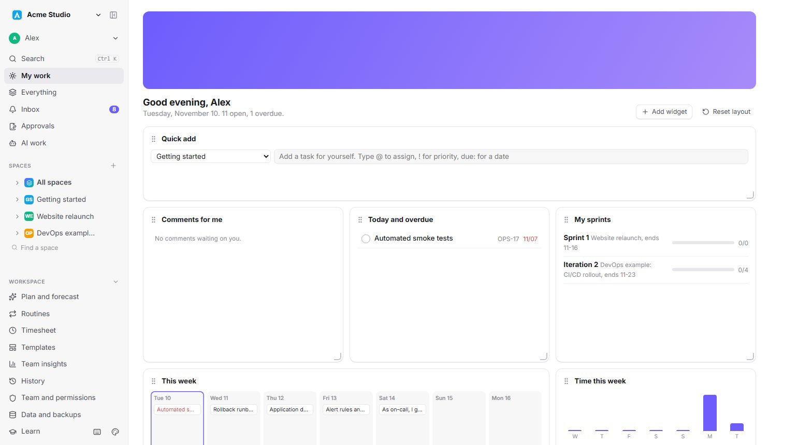
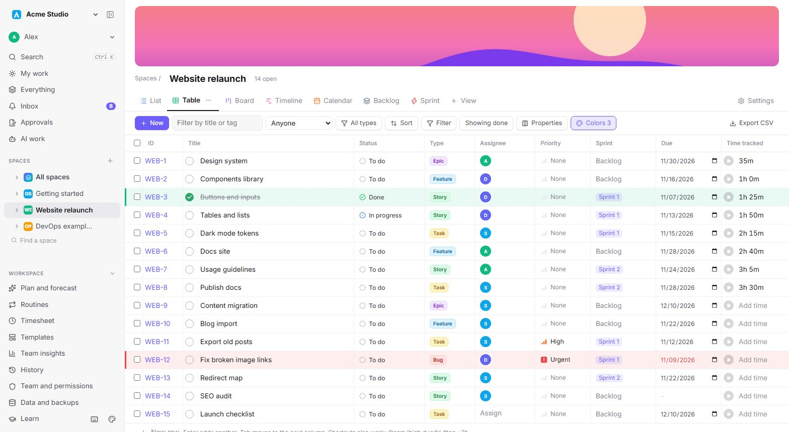
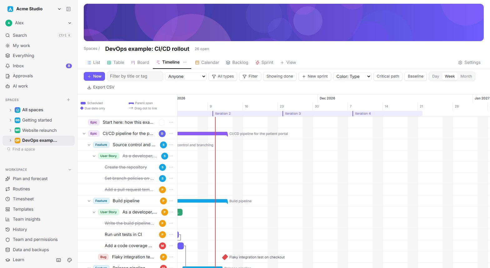
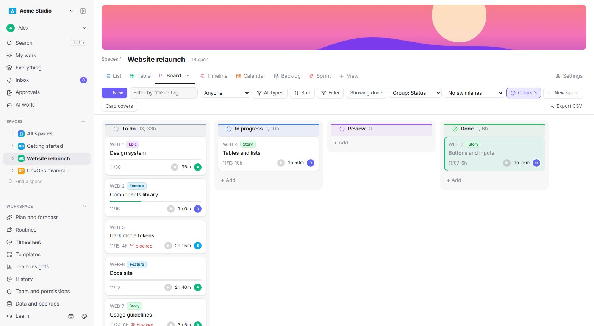
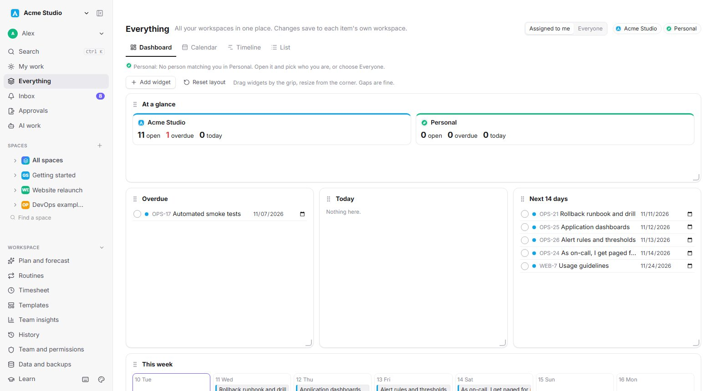
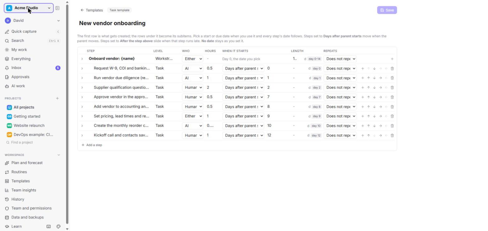
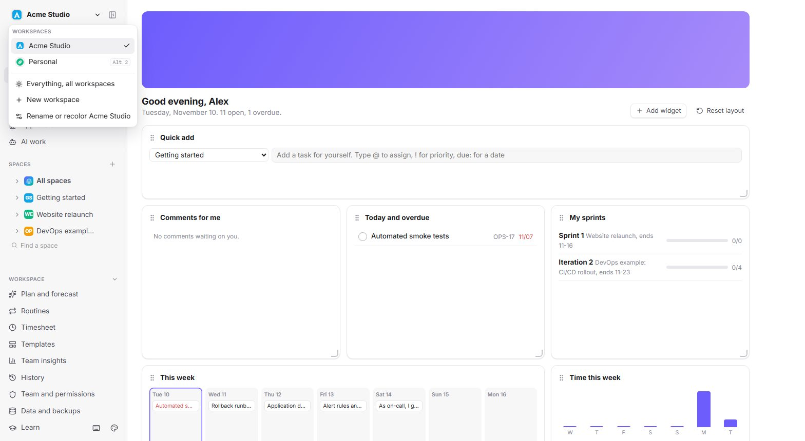
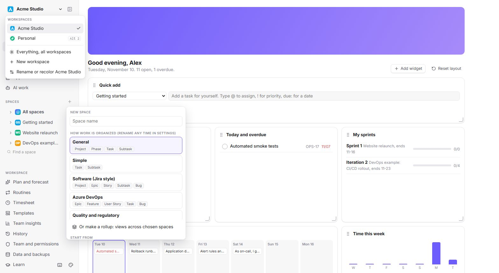
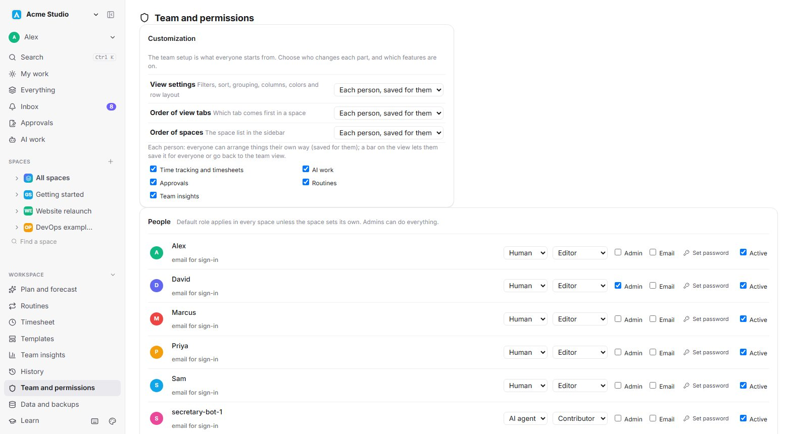

# Cadence

A fast, self-hosted project and task manager that takes the best parts of ClickUp, Notion, Asana, Jira, Linear and Azure Boards, with AI agents as first-class teammates.

One person or a whole company: keep separate workspaces for each business and for personal life, see everything due today across all of them, and let AI agents (Claude or any MCP client) plan, do and report on work while people approve it.



## Quick start

Needs Node 24 or newer (it uses the built-in `node:sqlite`) and pnpm.

```bash
pnpm install
pnpm demo
```

The demo opens on http://localhost:5191 with sample data: an "Acme Studio" work workspace and a "Personal" workspace. It keeps its data in `demo-data/`, apart from your own.

```bash
pnpm dev
```

Runs on http://localhost:5190 and keeps data in `data/`: one SQLite file per workspace, plus uploaded files and backups.

```bash
pnpm test
```

## Hosting with sign-in

```bash
pnpm build
pnpm start
```

Serves the app and API on http://127.0.0.1:8080 (set `PORT` and `HOST` to change). Sign-in is required: the first visit asks you to create the owner account, which becomes admin of every workspace. Invite everyone else from the Team page. One account works across all workspaces it belongs to.

- Put it behind HTTPS (Caddy, nginx or a tunnel) that sets `X-Forwarded-Proto`, so session cookies are marked Secure.
- `CADENCE_REQUIRE_LOGIN=0` turns forced sign-in off; `pnpm dev` leaves it off for local use.
- Locked out: `pnpm reset-password you@example.com` on the server prints a new password.

## Screenshots

| | |
| --- | --- |
|  |  |
|  |  |
|  |  |
|  |  |

## Features

### Work and structure
- Workspaces for each company or for personal life, each with its own data, files, backups and sign-in. Switch from the top of the sidebar or with Alt+1..9.
- Workspaces hold spaces (a team or area: Engineering, QA, Sales). Each space picks its levels when created: General (Project, Phase, Task, Subtask), Simple, Jira style (Project, Epic, Story, Subtask), Azure DevOps (Epic, Feature, User Story, Task), or your own. Statuses grouped into to do, doing and done, and custom fields. (The API calls a space a project.)
- Rollup space: one space that shows work from all spaces, or the ones you pick, in every view.
- Unlimited nesting, dependencies, multiple assignees, priorities, tags, estimates, start and due dates.
- Sidebar: search, favorites, drag to reorder, an icon and color kit per space; an arrow shows a space's views.

### Views
- List: an outline with nesting. Enter adds the next item, Tab indents, a hover gutter adds above or below and drags.
- Table: spreadsheet editing, resizable and reorderable columns, multi-level sort, filters, a property visibility panel, column totals (sum, average, min, max, counts, percent), and virtual scrolling for large tables.
- Board: Kanban by any field, swimlanes, WIP limits, card covers from image attachments.
- Timeline (Gantt): drag to move and resize, drag to link dependencies, parent spans, critical path, named baselines, sprint bands, and an overrun marker when subtasks run past a parent.
- Calendar, Workload (hours per person against capacity), Backlog, Sprint (burndown, velocity, capacity, rollover), and Files.
- Everything: one dashboard, calendar, timeline and list across all your workspaces, all editable.

### Columns and fields
- Text, number, money, select, multi-select, date, person, checkbox, URL, phone, email, rating, files.
- Relation (link items across spaces), rollup (count, sum, average, min, max, progress, earliest or latest due, over subitems or related items), and formula (math, text, logic and date functions over other columns).
- Automatic: created time, last edited time, created by.

### Writing fast
- Quick add everywhere: `Call vendor @sam !high #ops due:fri ~2h every:2w`. Typing `@`, `!`, `#`, `due:` or `every:` opens a picker, and the preview shows real dates.
- Quick capture from anywhere (C), with dictation. Command palette (Ctrl+K). Rebindable shortcuts.
- Block editor for descriptions: headings, lists, checklists, code, images (paste a screenshot), links to other items with `[[KEY-12]]`.

### Files
- Attach images, PDFs, Office documents and text to any item. Paste screenshots straight into descriptions.
- Drop files onto a List, Board or Files view to turn each file into its own task.
- A Files view per space (gallery or table) and a Files column.
- Quick view for images, PDFs and Google Drive, Docs, Sheets and Slides links.

### Repeating work and templates
- Repeat on a schedule or after completion: daily, weekdays, weekly on chosen days, monthly by date or nth weekday, quarterly, twice a year, yearly, every 2, 3 or 5 years; stop after a date or a count.
- A Routines page groups all repeating work, from daily to every few years.
- Templates like ClickUp: task templates at any level and space templates (levels, statuses, views, starting items). Create them from scratch, or save any item or space.
- Relative dates in templates: a step starts N days after its parent, or after the step before it, or has no date. Created items keep that link, so moving the parent moves its steps.
- A template gallery (vendor onboarding, compliance routines, new hire onboarding, AI agency work, a training checklist) and portable template packs you can export and import.

### AI agents
- Built-in MCP server (53 tools) over stdio and HTTP, with per-person tokens. See [docs/MCP.md](docs/MCP.md).
- People are human or AI. Mark work Human, AI or Either.
- AI work loop: an agent claims a task, a person accepts, the agent logs every step with links and screenshots, submits a report, and a person approves it or sends it back. AI agents can never approve their own work or mark it done.
- Planning helpers: estimate missing hours from similar finished work, replan schedules against capacity (proposed, then approved), and a hiring and budget forecast.

### Teams, security and approvals
- One account per person across every workspace on the server, first-run owner setup, sign-in with a password or Google, email invites with one-time links, roles with fine-grained permissions and per-space access.
- Approvals and e-signatures: request a review or approval, sign with a password re-check, and keep a fingerprint of what was signed. Workflow rules per item type (allowed moves, required fields, approval before done).
- Protections: CSRF and origin checks, rate-limited sign-in, hashed tokens and passwords, safe webhooks, CSV formula injection guards.

### Dashboards and insights
- My Work: a free-placement dashboard of widgets (focus, this week, sprints, time, charts, cumulative flow, inbox). Drag anywhere, leave gaps, resize.
- Team insights: finished work, on-time rate, estimates against actual time, flagged work.
- History of every change, with revert.

### Integrations
- Google: sign in, send notification emails through Gmail, connect personal calendars (read events, add events) and Gmail (search). A calendar feed (ICS) for any person or space.
- Webhooks, email to task, and a CRM-ready sync API (external ids, changes since a time).
- Automations: when an item is created, changes status, is completed, is assigned or passes its due date, then set fields, assign, notify, apply a template or close the parent.

### Data
- Automatic snapshots with daily, weekly and monthly retention, a copy of every uploaded file, JSON export and import, and CSV export of any view.

## How it is built

- **Client:** React 19 and TypeScript, no UI framework. State loads once, edits apply instantly (optimistic) and sync through Server-Sent Events, with undo and redo.
- **Server:** Node with the built-in `node:sqlite` (WAL mode), mounted as Vite middleware. One `Tasks` service class holds the rules; the REST API, the MCP server over stdio and the MCP server over HTTP all call it, so every path gets the same validation and permission checks.
- **Workspaces:** a small registry (`data/workspaces.json`) and one database per workspace. The client picks a workspace with a header, a query parameter or a cookie.
- **Permissions:** roles map to capabilities (view, comment, create, edit, delete, sprints, views, templates, settings, export). Tokens act as a person and pass through a guard on every service call.
- **Tests:** `node:test` with in-memory databases, covering the service rules, sign-in and permissions through the API, invites, templates and dynamic dates, formulas, files as tasks, the dashboard grid and the critical path.

Key files: `server/service.ts` (rules), `server/api.ts` (REST), `server/mcp.ts` (MCP tools), `src/App.tsx` (shell and routing), `src/*View.tsx` (views).

## Docs

- [docs/MCP.md](docs/MCP.md): connect Claude or any MCP client.
- [docs/AI-GUIDE.md](docs/AI-GUIDE.md): the guide agents read first.
- [docs/ROADMAP-NEXT.md](docs/ROADMAP-NEXT.md): what is planned next.
